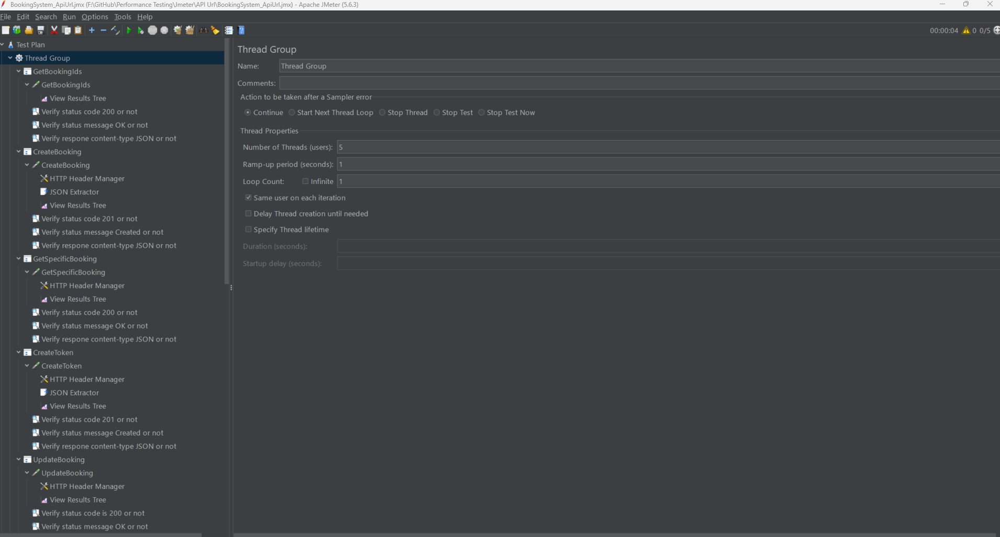
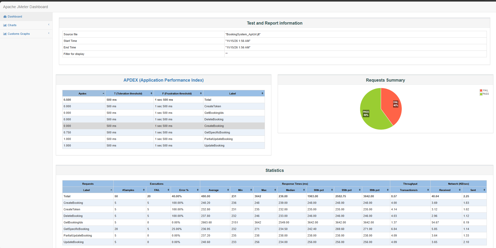

# Booking System API — Performance Testing

**Performance testing of RESTful Booking API using Apache JMeter**

[](https://jmeter.apache.org/)
[](https://)
[](https://)

A JMeter-based API test plan covering booking creation, retrieval, authentication, updates, deletion, and response validation.

---

## 📌 Table of Contents

- Project Overview
- Tools and Technologies
- Target API
- Test Configuration
- Test Scenarios
- Assertions and Validations
- Project Structure
- How to Run
- Generate HTML Performance Report
- Screenshots and Visual Previews
- Report Notes
- Author

## 📌 Project Overview

This project contains an Apache JMeter test plan for testing the **Restful Booker API** over HTTPS.

The test plan covers the main booking lifecycle, including:

- Retrieving booking IDs
- Creating a new booking
- Retrieving a specific booking
- Generating an authentication token
- Updating an existing booking
- Partially updating a booking
- Deleting a booking
- Verifying the expected response after deletion

The test plan uses JSON Extractors to capture the booking ID and authentication token from API responses. It also uses assertions to validate HTTP status codes, response messages, content types, and response bodies.

## 🧰 Tools and Technologies

| Tool / Technology | Purpose |
|---|---|
| Apache JMeter 5.6.3 | API performance and functional testing |
| REST API | Booking and authentication operations |
| HTTPS | Secure communication |
| JSON | Request and response payloads |
| JSON Extractor | Extract booking ID and authentication token |
| Response Assertion | Validate API responses |
| JMeter HTML Dashboard | Generate performance reports |

## 🌐 Target API

- **Base URL:** https://restful-booker.herokuapp.com
- **Booking resource:** `/booking`
- **Authentication resource:** `/auth`

## ⚙️ Test Configuration

The following configuration is used in the JMeter test plan:

| Configuration | Value |
|---|---:|
| JMeter version recorded in test plan | 5.6.3 |
| Thread Group | 1 |
| Number of threads (virtual users) | 5 |
| Ramp-up period | 1 second |
| Loop count | 1 |
| Total HTTP samplers | 10 |
| Protocol | HTTPS |
| On sampler error | Continue |

**Note:** These are the configured test settings, not measured performance results.

## 🧪 Test Scenarios

The test plan executes the following API test scenarios:

| # | Sampler | Method | Endpoint | Expected Response |
|---:|---|---|---|---|
| 1 | GetBookingIds | GET | `/booking` | 200 OK |
| 2 | CreateBooking | POST | `/booking` | 201 Created |
| 3 | GetSpecificBooking | GET | `/booking/${id}` | 200 OK |
| 4 | CreateToken | POST | `/auth` | 201 Created |
| 5 | UpdateBooking | PUT | `/booking/${id}` | 200 OK |
| 6 | GetSpecificBooking | GET | `/booking/${id}` | 200 OK |
| 7 | PartialUpdateBooking | PATCH | `/booking/${id}` | 200 OK |
| 8 | GetSpecificBooking | GET | `/booking/${id}` | 200 OK |
| 9 | DeleteBooking | DELETE | `/booking/${id}` | 200 OK |
| 10 | GetSpecificBooking | GET | `/booking/${id}` | 404 Not Found |

### JSON Extractors

The test plan uses JSON Extractors to capture dynamic values from API responses.

| Extractor | JSON Path | Variable |
|---|---|---|
| Booking ID | `$.bookingid` | `${id}` |
| Authentication Token | `$.token` | `${token}` |

The extracted booking ID is used in subsequent booking operations.

## ✅ Assertions and Validations

The JMeter test plan includes assertions to validate:

- HTTP response status codes: `200`, `201`, and `404`.
- HTTP response messages: `OK`, `Created`, and `Not Found`.
- Response content type: `application/json` for applicable JSON responses.
- Delete response body contains `Deleted Successfully`.
- Text response content type: `text/plain` for applicable delete responses.
- After deleting a booking, retrieving that booking should return `404 Not Found`.

These assertions help verify whether the API responses match the expected results.

## 📁 Project Structure

```text
BookingSystem-API-Performance-Test/
│
├── BookingSystem_ApiUrl.jmx
├── BookingSystem_ApiUrl.jtl
├── README.md
│
├── images/
│   ├── jmeter-interface.png
│   └── performance-dashboard.png
│
├── BookingSystem_ApiUrl.html/
│   └── index.html
│
└── report/
    └── index.html
```

*The `.jtl` results file and generated HTML report folder are created after running the commands below.*

## ▶️ How to Run

### 1. Prerequisites

- Install Java (a version supported by your JMeter installation).
- Install Apache JMeter.
- The test plan was saved using Apache JMeter 5.6.3.

### 2. Open the JMeter Test Plan

1. Start Apache JMeter.
2. Select **File → Open**.
3. Choose `BookingSystem_ApiUrl.jmx`.
4. Review the Thread Group and HTTP Request configurations.
5. Click the green **Start** button to execute the test.

### 3. Run the Test from the Command Line

Open a terminal or command prompt in the project directory.

Execute the following command to run the JMeter test plan in non-GUI mode and generate the results file:

```bash
jmeter -n -t BookingSystem_ApiUrl.jmx -l BookingSystem_ApiUrl.jtl
```

This command executes the test plan and saves the test results in `BookingSystem_ApiUrl.jtl`.

## 📊 Generate HTML Performance Report

After successfully executing the test and generating the `.jtl` results file, run the following command:

```bash
jmeter -g BookingSystem_ApiUrl.jtl -o BookingSystem_ApiUrl.html
```

This command generates the JMeter HTML dashboard report in the `BookingSystem_ApiUrl.html` directory.

### Steps to Generate the Report

**Step 1:** Execute the JMeter test plan.

```bash
jmeter -n -t BookingSystem_ApiUrl.jmx -l BookingSystem_ApiUrl.jtl
```

**Step 2:** Generate the HTML dashboard.

```bash
jmeter -g BookingSystem_ApiUrl.jtl -o BookingSystem_ApiUrl.html
```

**Step 3:** Open the generated report.

Navigate to the `BookingSystem_ApiUrl.html` directory and open `index.html` in your web browser.

**Important Notes:**

- Run both commands from the directory containing `BookingSystem_ApiUrl.jmx`.
- The first command generates the `.jtl` results file.
- The second command uses that `.jtl` file to generate the HTML dashboard.
- The output directory `BookingSystem_ApiUrl.html` must not already exist or must be empty before report generation.
- Do not modify the generated report files if you want the dashboard to work correctly.

## 🖼️ Screenshots and Visual Previews

### JMeter Test Plan Interface



*Illustrative interface mockup based on the uploaded JMeter test plan. This is not a direct screenshot captured from the JMeter application.*

### JMeter HTML Performance Dashboard



*Illustrative dashboard preview. Actual performance measurements should be taken from the HTML report generated using the `.jtl` results file.*

## 📝 Report Notes

The project also contains a supplied `report/index.html` file. It references additional supporting assets, including CSS, JavaScript, and dashboard resources.

For a complete and accurate performance report, generate a fresh HTML dashboard using the two JMeter commands described above.

The actual performance metrics, such as response time, throughput, error rate, and other dashboard statistics, depend on the test execution results stored in the `.jtl` file.

## 👤 Author

**Kanak Roy Shanda**

- 🐙 GitHub: [https://github.com/Kanak-Roy](https://github.com/Kanak-Roy)
- 💼 LinkedIn: [https://www.linkedin.com/in/kanak-roy-shanda-601961238/](https://www.linkedin.com/in/kanak-roy-shanda-601961238/)
- 📧 Email: [kanakroyshanda@gmail.com](mailto:kanakroyshanda@gmail.com)

---

**Thank you for visiting this repository!**